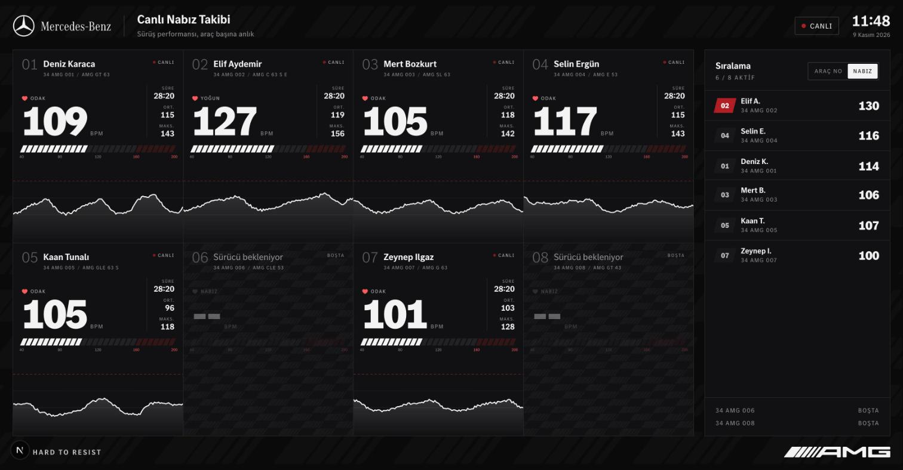
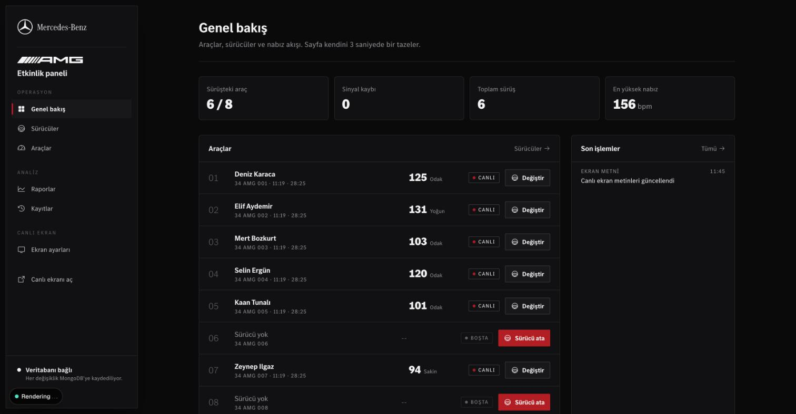
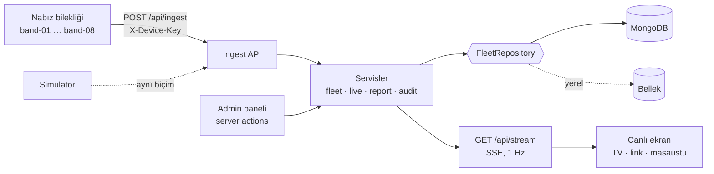

<div align="center">


# AMG Pulse

**Mercedes-AMG sürüş etkinliği için canlı nabız takibi.**

8 araç, her araçta sürücünün taktığı bir nabız bilekliği. Sürücünün kalp atışı saniye saniye
65 inç ekrana ve paylaşılan web linkine akar; iş bitiminde plaka bazında toplam rapor alınır.

[](package.json)
[](package.json)
[](tsconfig.json)
[](src/app/globals.css)
[](src/server/db/mongo-repository.ts)
[](#dağıtım)
[](desktop/)

[Hızlı başlangıç](#hızlı-başlangıç) · [mercedesctl](#mercedesctl) · [Mimari](#mimari) · [API](docs/API.md) · [Marka kiti](brand/README.md) · [Dağıtım](#dağıtım)

</div>

<table align="center"><tr>
<td align="center" valign="top"><br><sub>Canlı ekran (65" TV ve paylaşılan link)</sub></td>
<td align="center" valign="top"><br><sub>Admin paneli: genel bakış</sub></td>
</tr></table>

---

## Ne yapar

| Yüzey | Adres | Kim kullanır |
| --- | --- | --- |
| **Canlı ekran** | `/` | Garajdaki 65" TV ve link verilen herkes. 8 aracın nabzı, devir kadranı/barı, son 2 dakikanın izi, nabza ya da araç numarasına göre sıralama kulesi. Giriş gerekmez. |
| **Admin paneli** | `/admin` | Etkinlik ekibi (tek ortak şifre). Genel bakış, Sürücüler (ata / değiştir / adı düzelt / bitir), Biniş kayıtları, Araçlar (plaka, model), Raporlar, Kayıtlar (denetim), Ekran ayarları (başlıklar, kadran ya da bar göstergesi). Masaüstünde sidebar, mobilde alt sekme çubuğu. |
| **Ingest API** | `POST /api/ingest` | Araçlardaki nabız bileklikleri. Ölçülen nabzı kimliğiyle gönderir. |
| **Simülatör** | `simulator/` | Gerçek cihazlar yokken 8 bilekliği taklit eder; ingest API'ye gerçek cihazlarla aynı biçimde veri yollar. |
| **Masaüstü uygulaması** | `desktop/` | TV'ye bağlı bilgisayar için kiosk penceresi (Electron). Sunucu düşerse kendini toparlar. |

### Etkinlik akışı

1. Admin panelde 8 aracın plakası girilir (**Araçlar**). Bileklik eşleşmesi sabittir: N. araç = `band-0N`.
2. Araca biri binince **Sürücüler > Sürücü ata**: ad, soyad ve biniş saati (tarih otomatik: bugün).
3. Bileklik nabzı gönderir; canlı ekranda sürücünün adı ve kalp atışı belirir.
4. Sürücü değişince **Değiştir**: önceki sürüş seçilen saatte kapanır, yenisi başlar. Her ölçüm tek bir sürücüye aittir.
5. İş bitiminde **Raporlar > Toplam rapor (CSV)**: plaka başına her sürüş, süre, ortalama, en düşük, en yüksek nabız.
   Sürüş detayında grafik, nabız bölgelerinde geçen süre ve saniye saniye ham veri (CSV).

Admin'de yapılan her değişiklik (atama, ad düzeltme, plaka, ekran metni, giriş denemeleri) **Kayıtlar**'a önceki ve
sonraki değeriyle yazılır; kayıtlar silinmez. **Tüm loglar** (sidebar'ın sol altı) bileklikten gelen her ölçümü saniye
saniye akıtır; **Dışa aktar** tüm nabız ve işlem kayıtlarını CSV olarak indirir. Veri büyükse 5.000'lik parçalar halinde
çekilir, ilerleme marka yükleme çubuğunda görünür, iptal edilebilir.

Canlı ekranda tam ekran: başlıktaki düğme ya da `F`. Tam ekranda imleç 3 sn hareketsiz kalınca gizlenir.

**Yeni sürücü animasyonu.** Ekran açıkken bir araca sürücü atanınca: gösterge gerçek bir AMG'nin kontak anındaki gibi
kırmızı bölgeye kadar süpürüp gerçek nabza iner, logodaki beş şerit panelin üstünden geçer, panel kırmızı parlar,
ad aşağıdan yükselir ve 8 sn "Yeni sürücü" etiketi kalır. Sol altta yayın bandı ("Sürüşe başladı") kayarak girer;
aynı anda birden fazla biniş olursa sırayla gösterilir. Verinin aktığı başlıktaki sinyal şeritleri ve "ölçüm/dk"
sayacıyla, her panelde de iz ucundaki her yeni ölçümde yayılan halkayla görünür. Canlı ekran kırmızısı, TV'de sönük
kalmasın diye marka kırmızısının daha parlak tonudur (admin ve baskı marka kırmızısıyla kalır).

## Hızlı başlangıç

Gereken: Node.js 24+ (pnpm, corepack ile otomatik açılır).

```bash
./mercedesctl up
```

Bu tek komut bağımlılıkları kurar, `.env.local` oluşturur, web uygulamasını ve simülatörü başlatır, tarayıcıyı açar.
`MONGODB_URI` boşsa veriler bellekte tutulur ve 6 araca örnek sürücü atanır; hiçbir hesap gerekmez.

| | |
| --- | --- |
| Canlı ekran | http://localhost:3000 |
| Admin | http://localhost:3000/admin (şifre: `ADMIN_PASSWORD`, boşsa `amg-demo`) |

Durdurmak için `./mercedesctl down`.

## mercedesctl

Projenin tek kontrol noktası. Çalışma dosyaları (pid, log) `node_modules/.cache/mercedesctl/` altında tutulur:
proje içinde olsalardı Next'in dosya izleyicisi her log satırında sayfayı yeniden yüklerdi.

| Komut | Ne yapar |
| --- | --- |
| `up` | Kurulum (gerekirse) + web + simülatör, tarayıcıyı açar (`NO_OPEN=1` ile açmaz) |
| `down` | Hepsini durdurur |
| `status` | Neler çalışıyor, `/api/health` yanıtı |
| `logs [web\|sim\|desktop]` | Canlı log |
| `web` / `sim [ops]` | Tek tek başlatır. Simülatör seçenekleri: `--devices 4 --dropout 0 --seed 7` |
| `desktop [url]` | Masaüstü uygulaması; varsayılan yerel sunucu, istenirse Vercel adresi |
| `setup` | Bağımlılıklar + `.env.local` |
| `check` / `build` | Tip + lint / üstüne üretim build |
| `deploy [prod]` | Vercel önizleme ya da canlı dağıtım |
| `db:reset` | Sürüşler, ölçümler ve kayıtlar silinir, filo yeniden tohumlanır (onay ister; aynı veritabanını kullanan canlı ortamı da etkiler) |
| `doctor` | Node, pnpm, ortam değişkenleri, servis durumu |

## Mimari



Katmanlar tek yönlü bağımlıdır; her katman yalnız altındakini bilir:

| Katman | Klasör | Sorumluluk |
| --- | --- | --- |
| Domain | `src/domain/` | Saf tipler ve kurallar: nabız bölgeleri, geçerli aralık, istatistik, doğrulama, seri işlemleri. Framework yok, test edilebilir. |
| Veri | `src/server/db/` | `FleetRepository` arayüzü ve iki uygulaması: `MongoFleetRepository`, `MemoryFleetRepository`. Servisler yalnız arayüzü bilir. |
| Servis | `src/server/services/` | İş kuralları: sürücü atama (önceki sürüşü kapatma), ingest, canlı görüntü, rapor, denetim kaydı, ekran ayarları. |
| Taşıma | `src/app/api/`, `src/app/admin/actions.ts` | HTTP uç noktaları ve server action'lar: yetki, girdi doğrulama, servisi çağırma. İş kuralı içermez. |
| Arayüz | `src/components/`, `src/app/` | Canlı ekran (`live/`), admin (`admin/`), ortak öğeler (`ui/`), marka (`brand/`). |

### Güvenilirlik kararları

Etkinlik canlı yapıldığı için sistem "bir şey bozulursa ekran kararmasın" ilkesiyle kuruldu:

- **Canlı ekran hata sayfasına düşmez.** `getLiveSnapshot()` hiçbir zaman hata fırlatmaz: veritabanı yanıt vermezse son
  başarılı görüntü `stale: true` ile döner, ekran "Veri gecikiyor" der ve sonraki saniye yeniden dener.
- **SSE akışı kendini yeniler.** Vercel fonksiyonları süreli olduğu için akış 280 sn'de kapanır, tarayıcı 1 sn sonra
  yeniden bağlanır. 6 sn snapshot gelmezse rozet "Bağlantı yok"a döner.
- **Bileklik veriyi kaybetmez.** Ölçümler zaman damgasıyla kuyruğa girer; sunucuya ulaşılamazsa birikir ve tek istekte
  toplu gönderilir (en fazla 500). Saati kaymış cihazın zaman damgası sunucu saatine çekilir.
- **Toplu yazma.** Bir ingest isteği kaç ölçüm içerirse içersin MongoDB'ye sabit 3 toplu işlem yapar
  (ölçümler, sürüş istatistikleri, aracın son değeri). Sürüş özeti artımlı tutulur; rapor tüm ölçümleri taramaz.
- **Sürüşler karışmaz.** Sürücü değişince önceki sürüş tam o saatte kapanır. Sürüş başlamadan önce ölçülen değer yeni
  sürücünün raporuna yazılmaz. Geç gelen eski ölçüm daha yenisinin üzerine yazmaz.
- **Saatler İstanbul saatiyle.** Vercel UTC'de çalışır; tüm biçimlendirme `Europe/Istanbul` ile yapılır.
- **Denetim kaydı işlemi durdurmaz.** Kayıt yazılamazsa hata loglanır ama sürücü ataması geri alınmaz.

### Nabız kuralları

Hepsi tek dosyada: [`src/domain/heart-rate.ts`](src/domain/heart-rate.ts).

| Bölge | Aralık (bpm) | Ekranda |
| --- | --- | --- |
| Sakin | < 100 | beyaz |
| Odak | 100-129 | beyaz |
| Yoğun | 130-159 | beyaz |
| Kırmızı bölge | 160+ | AMG kırmızısı: rakam, kadran, panelin üst kenarı |

Geçerli ölçüm 30-230 bpm; 15 sn veri gelmezse "Sinyal yok".

## Depo yapısı

```
brand/                 Marka kiti: logolar, fontlar, desenler, renk ve kullanım kuralları (README)
desktop/               Electron masaüstü uygulaması (kiosk)
docs/API.md            Ingest ve okuma uç noktaları, bileklik için sözleşme
simulator/             Nabız bilekliği simülatörü (bağımlılıksız, Node 24+)
src/
  app/                 Sayfalar ve API (Next.js App Router)
    page.tsx           Canlı ekran
    admin/             Admin paneli: (panel)/ sayfalar, login, actions.ts
    api/               ingest · stream · live · health · admin/*/csv
  components/          live/ · admin/ · ui/ · brand/
  domain/              Saf tipler ve kurallar
  server/              db/ (depolar) · services/ · auth · env · http
  proxy.ts             /admin koruması (Next 16'da middleware'in adı)
mercedesctl            Yönetim betiği
```

## Teknoloji

Next.js 16 (App Router, Turbopack) · React 19 · TypeScript (strict) · Tailwind CSS 4 · Motion · Phosphor Icons ·
MongoDB Node.js sürücüsü 7 · Electron. Fontlar yalnız Mercedes kurumsal fontları (MB Corpo S Title, S Text, A).

## Yapılandırma

`.env.example` belgelenmiş şablondur; yerelde `.env.local`, Vercel'de proje ortam değişkenleri.

| Değişken | Zorunlu | Açıklama |
| --- | --- | --- |
| `MONGODB_URI` | Üretimde evet | Boşsa bellek modu (yalnız yerel deneme; Vercel'de kalıcı değildir). |
| `MONGODB_DB` | Hayır | Veritabanı adı, varsayılan `amg_pulse`. |
| `ADMIN_PASSWORD` | Üretimde evet | Admin ekip şifresi. Yerelde boşsa `amg-demo`. |
| `INGEST_KEY` | Üretimde evet | Bilekliklerin `X-Device-Key` başlığı. Üretmek için `openssl rand -hex 24`. |
| `DEMO_SEED` | Hayır | `true` ise boş veritabanına örnek sürücüler atanır. Etkinlikte `false`. |

MongoDB koleksiyonları ilk bağlantıda indeksleriyle otomatik oluşur: `vehicles`, `sessions`, `readings`,
`audit_log`, `settings`.

## Dağıtım

Vercel:

1. Projeyi Vercel'e bağlayın, ortam değişkenlerini girin (`MONGODB_URI`, `ADMIN_PASSWORD`, `INGEST_KEY`).
2. MongoDB Atlas'ta Network Access'e Vercel çıkış IP'lerini ya da `0.0.0.0/0` ekleyin.
3. `./mercedesctl deploy prod`.
4. Bilekliklere üretim adresini ve `INGEST_KEY`'i tanımlayın; `./mercedesctl desktop https://<alan-adı>` ile TV'yi açın.

Etkinlik öncesi kontrol listesi: `GET /api/health` `storage: "mongodb"` dönüyor mu, simülatörle 1 dakikalık deneme
(`node simulator/index.ts --url https://<alan-adı> --key <INGEST_KEY> --devices 1`), admin'de test sürüşünü bitirip
raporu indirin, sonra test kayıtlarını silmek için yeni bir veritabanı adı (`MONGODB_DB`) kullanın.

## Kurallar

- Nabız eşikleri, bölgeler ve süre sınırları yalnız `src/domain/heart-rate.ts`'te değişir.
- Yeni depo eklemek = `FleetRepository`'yi uygulayan tek dosya; servisler değişmez.
- Admin'e yeni bir değişiklik eylemi eklenirse `recordAudit` ile kaydı yazılır.
- AMG Red yalnız "aktive eder": birincil düğme, canlı göstergesi, kırmızı bölge. Kurallar: [brand/README.md](brand/README.md).
- `pnpm check` (tip + lint) temiz olmadan birleştirme yok.
