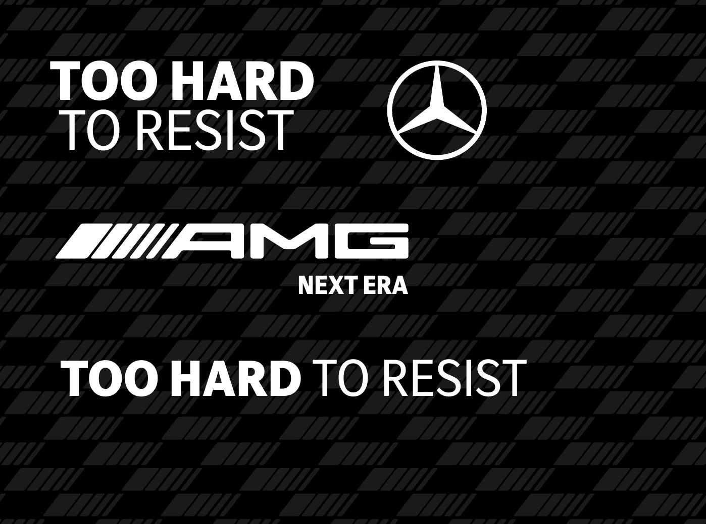

# Marka kiti

Mercedes-AMG'den gelen dosyaların (`amg_asset_Klasör`) düzenlenmiş hali. Uygulamadaki her renk, font ve logo buradan gelir.
Dosyalar lisanslıdır: yalnız bu etkinlik için kullanılır, repo dışına dağıtılmaz.

## İçerik

| Klasör | Ne var |
| --- | --- |
| `logos/amg/` | AMG wordmark ve "Driving Performance" sürümü; beyaz (koyu zemin) ve siyah (açık zemin). SVG, sıkı kırpılmış. |
| `logos/mercedes-star/` | Mercedes yıldızı: 2D (tek renk) ve 3D (web). |
| `fonts/` | MB Corpo S Title (Light, Regular, Bold, ExtraBold), MB Corpo S Text (Light, Regular, Bold), MB Corpo A Title Cond. |
| `patterns/` | AMG karbon ve dama bayrağı desenleri, koyu zemin için şeffaf beyaz PNG. |
| `references/` | Marka kılavuzu sayfaları (renk, logo plakası, plaka çerçevesi), kampanya görseli, 130 yıl görseli, logo animasyonu. |
| `source/` | Orijinal Illustrator dosyaları (.ai). |
| `tokens.json` | Renk, font, radius ve hareket değerleri; uygulamadaki karşılığı `src/app/globals.css`. |

## Kurallar

**Renk.** Zemin siyah, metin beyaz. **AMG Red `#B21E23` yalnız aktive eder** (kılavuz: "used exclusively for highlighting
text and graphical elements such as buttons"): birincil düğme, canlı göstergesi, kırmızı nabız bölgesi, sıralamada lider.
Başka vurgu rengi yoktur; durum bilgisi (canlı, sinyal yok) renk + etiketle verilir.

**Tipografi.** Yalnız Mercedes kurumsal fontları. Corpo S Title başlık ve rakamlarda, Corpo S Text metinde, Corpo A
(serif) yalnız "Mercedes-Benz" yazısında. Plaka: Corpo S Title Bold, beyaz, mat siyah zemin, yazının üstünde ve altında
yazı yüksekliğinin 3/4'ü kadar boşluk (`references/license-plate-frame-spec.png`).

**Logo.** Her yüzeyde Mercedes yıldızı + "Mercedes-Benz" kilidi (canlı ekran başlığı, admin sidebar, giriş, favicon);
AMG wordmark ikincil (canlı ekran alt bandı, admin). Logolar yalnız beyaz ya da siyah; kırmızıya boyanmaz, oranı değiştirilmez.
Logo plakası koruma alanı: logonun üstünde ve altında logo yüksekliği kadar boşluk (`references/logo-plate-spec.png`).

**Motif.** Logodaki eğik şeritler: devir barının segmentleri, sıralama kulesindeki numara kutuları. Karbon ve dama bayrağı
desenleri çok düşük opaklıkta zemin dokusu (boş araç paneli, giriş ekranı).

**Biçim.** Arayüz öğeleri keskin (2px), admin kartları hafif yumuşak (6px).

**Dil.** Kampanya sözü "TOO HARD TO RESIST" canlı ekranın alt bandında; admin'den değiştirilebilir. Büyük harf CSS ile
değil, metnin kendisiyle verilir (Türkçe sayfada CSS "i"yi "İ" yapar).
